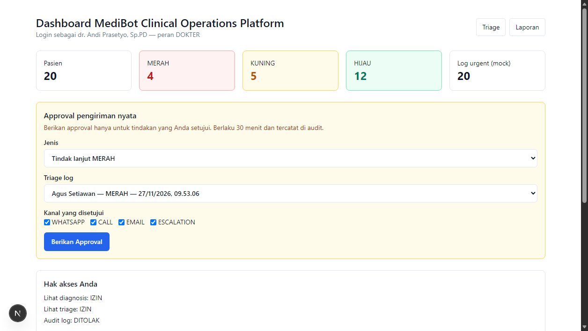
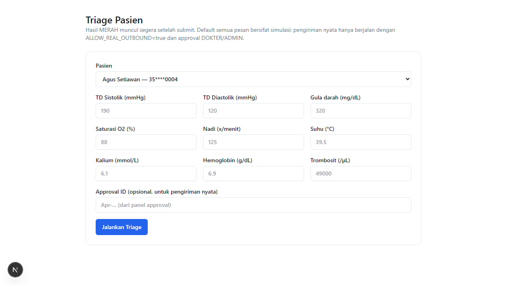
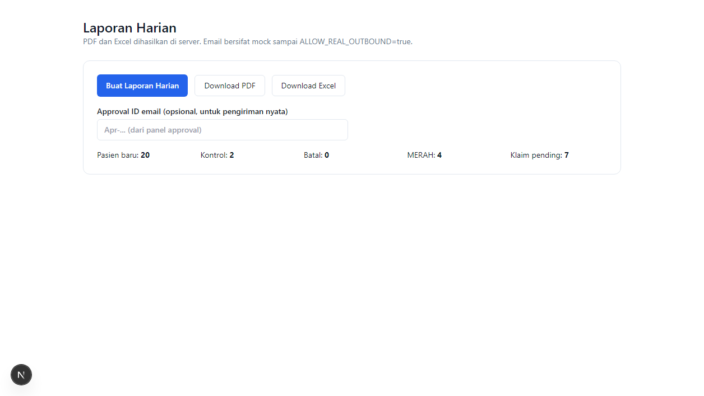

# MediBot Clinical Operations Platform

[English](README.md) | **Bahasa Indonesia**

> Fondasi operasional klinik multi-agent untuk klinik Indonesia — aman secara default, mock secara default, dapat diaudit secara desain.

[](https://github.com/riyanda-ex/medi-bot-agency-v3/actions/workflows/ci.yml)


MediBot Clinical Operations Platform adalah sistem Next.js App Router yang mengorkestrasi tujuh agent khusus untuk triase klinis, analisis rekam medis, pelaporan, audit keamanan, dan keterlibatan pasien. Sistem ini dibuat **aman untuk pengembangan lokal terlebih dahulu** dan memiliki kontrol hardening produksi.

> **Peringatan medis penting:** Perangkat lunak ini adalah prototipe pendukung keputusan, **bukan alat medis tersertifikasi**. Ambang triase adalah aturan internal dan harus divalidasi secara klinis sebelum digunakan pada pasien nyata.



## Tangkapan Layar

| Dashboard (Live)                                    | Triase (Live)                                 | Laporan (Live)                                  | Audit (Live)                                |
| --------------------------------------------------- | --------------------------------------------- | ----------------------------------------------- | ------------------------------------------- |
|  |  |  |  |

## Daftar Isi

- [Fitur Utama](#fitur-utama)
- [Postur Keamanan](#postur-keamanan)
- [Teknologi](#teknologi)
- [Mulai Cepat](#mulai-cepat)
- [Perintah yang Tersedia](#perintah-yang-tersedia)
- [Struktur Proyek](#struktur-proyek)
- [Konfigurasi](#konfigurasi)
- [Deployment Produksi](#deployment-produksi)
- [Dokumentasi](#dokumentasi)
- [Kontribusi & Keamanan](#kontribusi--keamanan)
- [Lisensi & HKI](#lisensi--hki)

## Fitur Utama

- **7 agent**: RME Analyzer, Orchestrator, Bug Hunter, Auto Reporter, Urgent Triage + Auto Caller, Security Guard, Patient Engagement.
- **Akses berbasis peran**: DOKTER, PERAWAT, RESEPSIONIS, ADMIN, PASIEN dengan RBAC fail-closed.
- **Alur triase urgent**: evaluasi MERAH/KUNING/HIJAU berbasis aturan dengan audit log dan simulasi tindak lanjut.
- **Gerbang approval manusia**: aksi outbound nyata memerlukan approval DOKTER/ADMIN (HMAC-signed, TTL 30 menit).
- **Auditabilitas**: catatan audit bertanda tangan untuk akses API, penolakan, approval, dan aksi penting.
- **Pelaporan**: laporan harian PDF/Excel dengan unduhan streaming dan pembatasan di folder `reports/`.
- **Privasi & akun**: MFA TOTP, tautan reset sekali pakai, retensi klinis 25 tahun, tiket hak subjek data
  dengan SLA 72 jam, legal hold, dan pencabutan sesi oleh admin.
- **Default aman**: provider WhatsApp/telepon/email mock, tidak ada kunci asli di repo, outbound dimatikan secara default.

## Postur Keamanan

Kontrol yang sudah diimplementasikan:

- NextAuth credentials + JWT, revalidasi sesi ke DB, blokir sesi invalid.
- RBAC fail-closed dan redaksi data sesuai peran (diagnosis disembunyikan dari role tidak berwenang).
- Enkripsi AES-256-GCM untuk field sensitif; hashing/masking NIK.
- Audit log bertanda tangan dengan konteks aktor/peran/metode/path/IP/user-agent.
- Rate limiting, cek same-origin untuk API mutasi, `Cache-Control: no-store` pada respons API.
- Security headers/CSP via `next.config.mjs` dan header proxy untuk route terlindungi.
- Job queue HMAC-signed/Zod-validated; cek keamanan Redis produksi (password/TLS host publik).
- Guard env produksi menolak secret placeholder/DEV/CI, `SYNC_MODE=true`, dan approval manusia dimatikan.
- Consent untuk tindak lanjut WhatsApp/telepon ke pasien diperiksa ulang saat eksekusi
  (`agents/urgentCaller.ts`); email laporan ke staf hanya digate approval (`agents/reporter.ts`),
  bukan consent pasien. Approval sekali pakai dan penolakan tercatat di audit.
- Tanda tangan audit diverifikasi dengan `npm run audit:verify`; retensi rutin produksi tidak pernah
  menghapus massal baris audit (pengecualian terdokumentasi: seed destruktif dev/test).
- Metrik hanya tersedia dengan `METRICS_TOKEN` terpisah dan tidak memuat PHI.

> Tidak ada sistem yang bisa dijamin “tidak bisa diretas”. Sebelum deployment klinis nyata, selesaikan [Checklist Produksi](docs/PRODUCTION-CHECKLIST.md), penetration test eksternal, dan review legal/kepatuhan.

## Teknologi

| Area       | Teknologi                                                            |
| ---------- | -------------------------------------------------------------------- |
| Framework  | Next.js 16.4.6 (App Router), React 19                                |
| Bahasa     | TypeScript (strict)                                                  |
| Styling/UI | Tailwind CSS, pola shadcn/ui, Radix primitives                       |
| Data       | Prisma, SQLite (default dev), PostgreSQL (produksi)                  |
| Auth       | NextAuth Credentials/JWT                                             |
| Queue      | Sync default; BullMQ + Redis opsional                                |
| Testing    | Vitest, skrip E2E, skrip cek queue                                   |
| CI         | GitHub Actions (Windows verify, PostgreSQL/Redis E2E, BullMQ worker) |

## Mulai Cepat

### Prasyarat

- Windows PowerShell (diuji), Node.js 24+, npm 11.20.0 (`packageManager`)
- Docker **tidak wajib** untuk dev lokal (SQLite + `SYNC_MODE=true`)

### Instalasi & Jalankan

```powershell
Copy-Item .env.example .env
npm install
npm run db:setup
npm test
npm run dev
```

Buka `http://localhost:3000`.

### Akun Pengembangan Lokal

> Hanya untuk pengembangan lokal. Form login tidak mengisi otomatis. Seed destruktif hanya berjalan di `development`/`test` dengan `ALLOW_DESTRUCTIVE_SEED=1`; produksi selalu diblokir. Kata sandi berasal dari `SEED_ADMIN_PASSWORD` (atau nilai acak yang dicetak sekali bila tidak diisi).

| Peran       | Email                        | Kata sandi                   | Akses Diagnosis |
| ----------- | ---------------------------- | ---------------------------- | --------------- |
| DOKTER      | `dokter@klinik.example`      | `SEED_ADMIN_PASSWORD` / acak | Ya              |
| PERAWAT     | `perawat@klinik.example`     | `SEED_ADMIN_PASSWORD` / acak | Triase saja     |
| RESEPSIONIS | `resepsionis@klinik.example` | `SEED_ADMIN_PASSWORD` / acak | Tidak           |
| ADMIN       | `admin@klinik.example`       | `SEED_ADMIN_PASSWORD` / acak | Ya              |
| PASIEN      | `pasien@klinik.example`      | `SEED_ADMIN_PASSWORD` / acak | Data sendiri    |

## Perintah yang Tersedia

Daftar lengkap (sumber: [`package.json`](package.json)):

| Perintah                       | Deskripsi                                                               |
| ------------------------------ | ----------------------------------------------------------------------- |
| `npm run dev`                  | Jalankan server development Next.js.                                    |
| `npm run build`                | Buat build produksi.                                                    |
| `npm run prestart`             | Siapkan standalone output (hook lifecycle sebelum `start`).             |
| `npm run start`                | Jalankan server produksi dari `.next/standalone`.                       |
| `npm run typecheck`            | Cek TypeScript (alias TS6).                                             |
| `npm run typecheck:7`          | Cek TypeScript native TS7.                                              |
| `npm run test`                 | Jalankan test Vitest (`npm test` sama).                                 |
| `npm run test:ci`              | Jalankan Vitest dengan coverage di CI.                                  |
| `npm run test:watch`           | Jalankan Vitest mode watch.                                             |
| `npm run verify:agents`        | Smoke-test agent dan DB.                                                |
| `npm run queue:worker`         | Jalankan worker BullMQ (butuh `QUEUE_MODE=redis`).                      |
| `npm run e2e`                  | Jalankan cek HTTP E2E terhadap server berjalan.                         |
| `npm run queue:check`          | Verifikasi queue Redis mengembalikan 202 + `jobId`.                     |
| `npm run queue:replay`         | Lihat/replay job gagal dari DLQ (`--list` atau `<jobId>`).              |
| `npm run prisma:generate`      | Generate Prisma client dari schema SQLite.                              |
| `npm run prisma:generate:pg`   | Sinkronkan schema PostgreSQL dan generate client-nya.                   |
| `npm run db:push`              | Push schema SQLite (hanya dev lokal).                                   |
| `npm run db:migrate:dev`       | Buat/terapkan migrasi SQLite development.                               |
| `npm run db:migrate:deploy`    | Terapkan migrasi SQLite (DB baru).                                      |
| `npm run db:migrate:deploy:pg` | Terapkan migrasi PostgreSQL via `prisma/postgres.config.ts` (produksi). |
| `npm run db:backup:pg`         | Backup `pg_dump` dengan pemangkasan retensi.                            |
| `npm run db:restore:pg`        | `pg_restore` dengan konfirmasi eksplisit.                               |
| `npm run audit:verify`         | Verifikasi tanda tangan HMAC baris audit.                               |
| `npm run retention:sweep`      | Selaraskan retensi 25 tahun dan laporkan tiket DSR.                     |
| `npm run perf:check`           | Uji beban singkat dengan SLO p95/error rate.                            |
| `npm run db:seed`              | Seed data dev/test (destruktif; dijaga flag env).                       |
| `npm run db:setup`             | `prisma:generate` + `db:push` + `db:seed` (dev saja).                   |
| `npm run db:push:pg`           | Push schema PostgreSQL (dev/test saja; jangan di produksi).             |
| `npm run db:setup:pg`          | `prisma:generate:pg` + `db:push:pg` + `db:seed` (dev/test saja).        |
| `npm run db:studio`            | Buka Prisma Studio.                                                     |
| `npm run postinstall`          | Generate Prisma client otomatis setelah install (hook lifecycle).       |
| `npm run lint`                 | Jalankan ESLint.                                                        |
| `npm run lint:fix`             | Jalankan ESLint dengan `--fix`.                                         |
| `npm run format`               | Jalankan Prettier write.                                                |
| `npm run format:check`         | Cek format Prettier.                                                    |
| `npm run test:coverage`        | Jalankan test dengan coverage.                                          |
| `npm run openapi:check`        | Validasi `openapi.yaml` via `scripts/check-openapi.mjs`.                |
| `npm run verify:all`           | lint, format, dua typecheck, test, audit, build, OpenAPI.               |

Produksi memakai migrasi (`npm run db:migrate:deploy:pg` atau service `migrate` di compose).
**Jangan** pakai `prisma db push` maupun `npm run db:setup:pg` pada data produksi.

## Struktur Proyek

Lihat [`docs/STRUCTURE.md`](docs/STRUCTURE.md) untuk aturan penempatan file dan area sensitif keamanan.

```text
app/         UI + API routes Next.js App Router
agents/      7 agent domain
lib/         Shared auth/rbac/env/crypto/audit/queue/guards
components/  Komponen UI
prisma/      Schema + seed
scripts/     Worker, E2E, cek queue, sinkron schema
tests/       Tes Vitest
fixes/       Artefak/helper bug-hunter
docs/        Arsitektur, API, struktur, checklist produksi, ADR
.github/     CI, CodeQL, Dependabot, template, CODEOWNERS
```

## Konfigurasi

Salin `.env.example` ke `.env`. Variabel penting:

| Variabel                 | Default      | Tujuan                                              |
| ------------------------ | ------------ | --------------------------------------------------- |
| `WHATSAPP_PROVIDER`      | `mock`       | `mock`, `fonnte`, `wablas`                          |
| `PHONE_PROVIDER`         | `mock`       | `mock`, `twilio`                                    |
| `ALLOW_REAL_OUTBOUND`    | `false`      | Aktifkan outbound nyata hanya dengan gate approval. |
| `REQUIRE_HUMAN_APPROVAL` | `true`       | Wajib untuk outbound nyata; dipaksa di produksi.    |
| `QUEUE_MODE`             | `sync`       | `sync` atau `redis`.                                |
| `REDIS_URL`              | -            | Wajib untuk mode queue Redis.                       |
| `TRUST_PROXY`            | kosong       | IP proxy tepercaya untuk forwarded client IP.       |
| `SYNC_MODE`              | `true` (dev) | Harus `false` di produksi.                          |
| `RATE_LIMIT_MODE`        | `auto`       | `auto`, `memory`, `redis` untuk rate limiter.       |
| `APP_SIGNING_KEY`        | kosong       | Wajib di produksi; kunci HMAC terpisah.             |
| `METRICS_TOKEN`          | kosong       | Bearer token `/api/metrics`; kosong = nonaktif.     |

Lihat `.env.example` untuk daftar lengkap.

## Deployment Produksi

1. Ikuti [`docs/PRODUCTION-CHECKLIST.md`](docs/PRODUCTION-CHECKLIST.md).
2. Sediakan PostgreSQL + Redis (jaringan privat, auth/TLS sesuai kebutuhan).
3. Set secret kuat dan env guard produksi.
4. Jalankan seluruh stack; service `migrate` akan menyinkronkan schema dan menerapkan migrasi
   sebelum app siap, lalu worker berjalan sebagai proses terpisah:

```powershell
docker compose --profile app up -d
```

Untuk deployment host-managed, terapkan migrasi lebih dulu dengan
`npm run db:migrate:deploy:pg` (`npx prisma migrate deploy --config prisma/postgres.config.ts`),
lalu build dan jalankan server serta worker secara terpisah. Healthcheck app memakai `/api/ready`.
**Jangan** pakai `prisma db push` atau `npm run db:setup:pg` pada data produksi.
`QUEUE_MODE=redis` mengembalikan HTTP 202 + `jobId` untuk pekerjaan yang diantrikan.

## Dokumentasi

- [`docs/ARCHITECTURE.md`](docs/ARCHITECTURE.md) — desain sistem dan alur data.
- [`docs/API.md`](docs/API.md) — ringkasan endpoint API.
- [`docs/STRUCTURE.md`](docs/STRUCTURE.md) — layout repo dan aturan penempatan.
- [`docs/PRODUCTION-CHECKLIST.md`](docs/PRODUCTION-CHECKLIST.md) — checklist hardening deployment.
- [`docs/THREAT-MODEL.md`](docs/THREAT-MODEL.md) — model ancaman STRIDE.
- [`docs/PRIVACY-DATA-HANDLING.md`](docs/PRIVACY-DATA-HANDLING.md) — penanganan data/privasi.
- [`docs/DATA-LIFECYCLE.md`](docs/DATA-LIFECYCLE.md) — state machine consent/penghapusan dan backup.
- [`docs/STAFF-GUIDE.md`](docs/STAFF-GUIDE.md) — panduan harian staf klinik tanpa teknis.
- [`docs/SOP-KLINIK.md`](docs/SOP-KLINIK.md) — draf SOP klinik yang perlu ditandatangani.
- [`docs/INCIDENT-RESPONSE.md`](docs/INCIDENT-RESPONSE.md) — runbook respons insiden.
- [`TESTING.md`](TESTING.md) — protokol pengujian.
- [`SECURITY.md`](SECURITY.md) — pelaporan kerentanan.
- [`CHANGELOG.md`](CHANGELOG.md) — perubahan penting.

## Kontribusi & Keamanan

- Baca [`CONTRIBUTING.md`](CONTRIBUTING.md) dan [`CODE_OF_CONDUCT.md`](CODE_OF_CONDUCT.md).
- **Jangan laporkan kerentanan keamanan di issue publik.** Ikuti [`SECURITY.md`](SECURITY.md).
- Repo ini proprietary; kontribusi eksternal butuh izin tertulis owner.

## Lisensi & HKI

- [`LICENSE`](LICENSE) — Lisensi komersial proprietary v3.1 (All Rights Reserved). Pemilik: `riyanda-ex`.
- [`PATENT.md`](PATENT.md) — Status paten dan draft materi. **Belum ada paten yang diajukan/diberikan.** Jangan beri label “Patent Pending” tanpa bukti resmi.

README ini bersifat informasional, bukan nasihat hukum atau medis.
