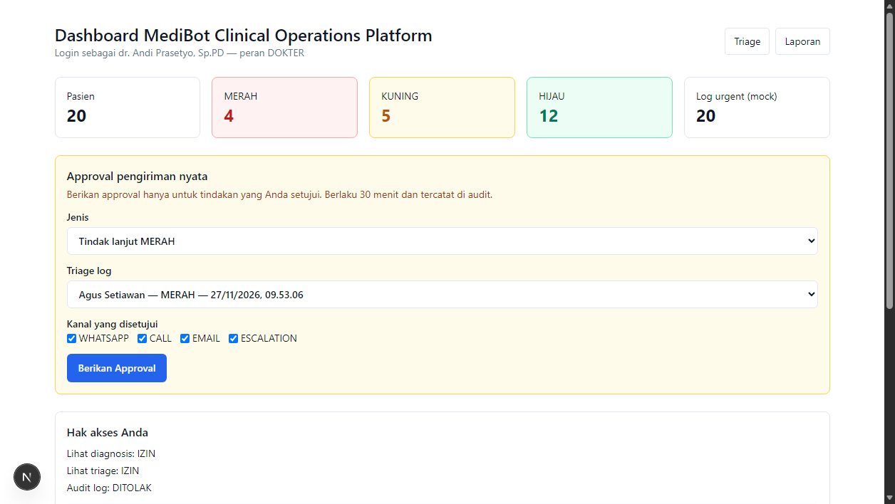
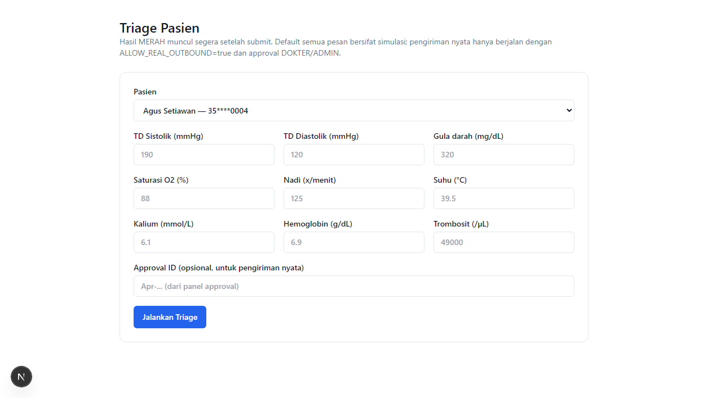
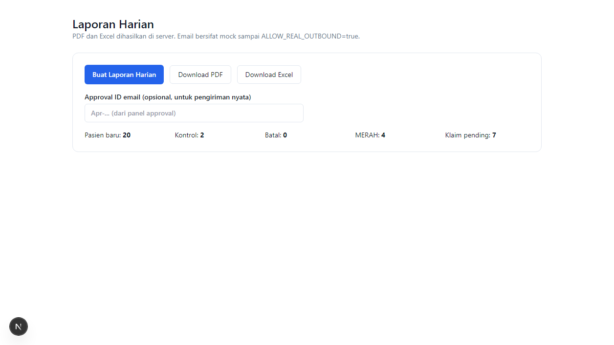

# MediBot Clinical Operations Platform

**English** | [Bahasa Indonesia](README.id.md)

> Multi-agent clinical operations foundation for Indonesian clinics — secure by default, mock by default, auditable by design.

[](https://github.com/riyanda-ex/medi-bot-agency-v3/actions/workflows/ci.yml)


MediBot Clinical Operations Platform is a Next.js App Router system that orchestrates seven specialized agents for clinical triage, medical record analysis, reporting, security auditing, and patient engagement. It is built for **safe local development first** and includes production hardening controls.

> **Important medical disclaimer:** This software is a decision-support prototype, **not a certified medical device**. Triage thresholds are internal rules and must be clinically validated before any real-patient use.



## Screenshots

| Dashboard (Live)                                    | Triage (Live)                                 | Reports (Live)                                  | Audit (Live)                                |
| --------------------------------------------------- | --------------------------------------------- | ----------------------------------------------- | ------------------------------------------- |
|  |  |  |  |

## Table of Contents

- [Key Features](#key-features)
- [Security Posture](#security-posture)
- [Tech Stack](#tech-stack)
- [Quick Start](#quick-start)
- [Available Scripts](#available-scripts)
- [Project Structure](#project-structure)
- [Configuration](#configuration)
- [Production Deployment](#production-deployment)
- [Documentation](#documentation)
- [Contributing & Security](#contributing--security)
- [License & IP](#license--ip)

## Key Features

- **7 agents**: RME Analyzer, Orchestrator, Bug Hunter, Auto Reporter, Urgent Triage + Auto Caller, Security Guard, Patient Engagement.
- **Role-based access**: DOKTER, PERAWAT, RESEPSIONIS, ADMIN, PASIEN with fail-closed RBAC.
- **Urgent triage workflow**: rule-based RED/YELLOW/GREEN evaluation with audit logging and simulated outbound follow-up.
- **Human approval gate**: real outbound actions require explicit DOKTER/ADMIN approval (HMAC-signed, 30-minute TTL).
- **Auditability**: signed audit records for API access, denials, approvals, and critical actions.
- **Reporting**: PDF/Excel daily reports with streaming downloads and containment under `reports/`.
- **Privacy & account controls**: TOTP MFA, single-use reset links, 25-year clinical retention,
  data-subject tickets with a 72 h SLA, legal hold, and admin session revocation.
- **Safe defaults**: mock WhatsApp/phone/email providers, no real keys in repo, outbound disabled by default.

## Security Posture

Implemented controls:

- NextAuth credentials + JWT, DB session revalidation, invalid-session blocking.
- Fail-closed RBAC and role-aware data redaction (diagnosis hidden from unauthorized roles).
- AES-256-GCM field encryption for sensitive patient fields; NIK hashing/masking.
- Signed audit logs with actor/role/method/path/IP/user-agent context.
- Rate limiting, same-origin checks for mutating APIs, `Cache-Control: no-store` on API responses.
- Security headers/CSP via `next.config.mjs` and protected-route proxy headers.
- Signed/Zod-validated queue jobs; Redis production checks for password/TLS on public hosts.
- Production env guards reject placeholder/DEV/CI secrets, `SYNC_MODE=true`, and disabled human approval.
- Consent for patient-directed WhatsApp/phone follow-up is re-checked at execution (`agents/urgentCaller.ts`);
  staff report email is gated by approval only (`agents/reporter.ts`), not by patient consent.
  Approvals are single-use and denials are audited.
- Audit signatures are verified with `npm run audit:verify`; routine production retention never
  bulk-deletes audit rows (the destructive dev/test seed is the documented exception).
- Metrics are exposed only with a separate `METRICS_TOKEN`; no PHI is present in metrics.

> No system can be guaranteed “unhackable”. Before real clinical deployment, complete the [Production Checklist](docs/PRODUCTION-CHECKLIST.md), external penetration testing, and legal/compliance review.

## Tech Stack

| Area       | Technology                                                           |
| ---------- | -------------------------------------------------------------------- |
| Framework  | Next.js 16.4.6 (App Router), React 19                                |
| Language   | TypeScript (strict)                                                  |
| Styling/UI | Tailwind CSS, shadcn/ui pattern, Radix primitives                    |
| Data       | Prisma, SQLite (dev default), PostgreSQL (production)                |
| Auth       | NextAuth Credentials/JWT                                             |
| Queue      | Sync mode default; BullMQ + Redis optional                           |
| Testing    | Vitest, E2E script, queue check script                               |
| CI         | GitHub Actions (Windows verify, PostgreSQL/Redis E2E, BullMQ worker) |

## Quick Start

### Prerequisites

- Windows PowerShell (tested), Node.js 24+, npm 11.20.0 (`packageManager`)
- Docker **not required** for local dev (SQLite + `SYNC_MODE=true`)

### Install & Run

```powershell
Copy-Item .env.example .env
npm install
npm run db:setup
npm test
npm run dev
```

Open `http://localhost:3000`.

### Local Development Accounts

> For local development only. Login form does not auto-fill credentials. Seed is destructive and
> only runs with `NODE_ENV=development|test` **and** `ALLOW_DESTRUCTIVE_SEED=1`; production always
> blocks it. The password comes from `SEED_ADMIN_PASSWORD` (or a randomly generated value printed
> once). The value below is the `.env.example` default.

| Role        | Email                        | Password                | Diagnosis Access |
| ----------- | ---------------------------- | ----------------------- | ---------------- |
| DOKTER      | `dokter@klinik.example`      | `dev-only-password-123` | Yes              |
| PERAWAT     | `perawat@klinik.example`     | `dev-only-password-123` | Triage only      |
| RESEPSIONIS | `resepsionis@klinik.example` | `dev-only-password-123` | No               |
| ADMIN       | `admin@klinik.example`       | `dev-only-password-123` | Yes              |
| PASIEN      | `pasien@klinik.example`      | `dev-only-password-123` | Own data         |

## Available Scripts

Complete script list (source: [`package.json`](package.json)):

| Command                        | Description                                                               |
| ------------------------------ | ------------------------------------------------------------------------- |
| `npm run dev`                  | Start Next.js development server.                                         |
| `npm run build`                | Create production build.                                                  |
| `npm run prestart`             | Prepare standalone output (lifecycle hook for `start`).                   |
| `npm run start`                | Start production server from `.next/standalone`.                          |
| `npm run typecheck`            | Run TypeScript checks (TS6 alias).                                        |
| `npm run typecheck:7`          | Run TS7 native compiler check.                                            |
| `npm run test`                 | Run Vitest suite (`npm test` is equivalent).                              |
| `npm run test:ci`              | Run Vitest with coverage in CI.                                           |
| `npm run test:watch`           | Run Vitest in watch mode.                                                 |
| `npm run verify:agents`        | Smoke-test agents and DB.                                                 |
| `npm run queue:worker`         | Run BullMQ worker (requires `QUEUE_MODE=redis`).                          |
| `npm run e2e`                  | Run HTTP E2E checks against a running server.                             |
| `npm run queue:check`          | Verify Redis queue returns 202 + `jobId`.                                 |
| `npm run queue:replay`         | List/replay failed BullMQ jobs from the DLQ (`--list` or `<jobId>`).      |
| `npm run prisma:generate`      | Generate Prisma client from the SQLite schema.                            |
| `npm run prisma:generate:pg`   | Sync PostgreSQL schema and generate its Prisma client.                    |
| `npm run db:push`              | Push SQLite schema (local dev only).                                      |
| `npm run db:migrate:dev`       | Create/apply an SQLite development migration.                             |
| `npm run db:migrate:deploy`    | Apply SQLite migrations (fresh DB).                                       |
| `npm run db:migrate:deploy:pg` | Apply PostgreSQL migrations via `prisma/postgres.config.ts` (production). |
| `npm run db:backup:pg`         | `pg_dump` backup with retention pruning.                                  |
| `npm run db:restore:pg`        | Confirmation-gated `pg_restore` (see docs).                               |
| `npm run audit:verify`         | Verify HMAC signatures of persisted audit rows.                           |
| `npm run retention:sweep`      | Realign 25-year retention and report overdue DSR tickets.                 |
| `npm run perf:check`           | Smoke load test with p95/error-rate SLO.                                  |
| `npm run db:seed`              | Seed dev/test data (destructive; guarded by env flags).                   |
| `npm run db:setup`             | `prisma:generate` + `db:push` + `db:seed` (dev only).                     |
| `npm run db:push:pg`           | Push PostgreSQL schema (dev/test only; never production).                 |
| `npm run db:setup:pg`          | `prisma:generate:pg` + `db:push:pg` + `db:seed` (dev/test only).          |
| `npm run db:studio`            | Open Prisma Studio.                                                       |
| `npm run postinstall`          | Generate Prisma client automatically after install (lifecycle hook).      |
| `npm run lint`                 | Run ESLint.                                                               |
| `npm run lint:fix`             | Run ESLint with `--fix`.                                                  |
| `npm run format`               | Run Prettier write.                                                       |
| `npm run format:check`         | Check Prettier formatting.                                                |
| `npm run test:coverage`        | Run Vitest with coverage.                                                 |
| `npm run openapi:check`        | Validate `openapi.yaml` via `scripts/check-openapi.mjs`.                  |
| `npm run verify:all`           | lint, format, both typechecks, tests, audit verify, build, OpenAPI check. |

Production deploys use migrations (`npm run db:migrate:deploy:pg` or the compose `migrate` service).
Do **not** use `prisma db push` or `npm run db:setup:pg` on production data.

## Project Structure

See [`docs/STRUCTURE.md`](docs/STRUCTURE.md) for placement rules and security-sensitive areas.

```text
app/         Next.js App Router UI + API routes
agents/      7 domain agents
lib/         Shared auth/rbac/env/crypto/audit/queue/guards
components/  UI components
prisma/      Schema + seed
scripts/     Worker, E2E, queue checks, schema sync
tests/       Vitest tests
fixes/       Bug-hunter artifacts/helpers
docs/        Architecture, API, structure, production checklist
.github/     CI, Dependabot, templates, CODEOWNERS
```

## Configuration

Copy `.env.example` to `.env`. Key variables:

| Variable                 | Default      | Purpose                                                    |
| ------------------------ | ------------ | ---------------------------------------------------------- |
| `WHATSAPP_PROVIDER`      | `mock`       | `mock`, `fonnte`, `wablas`                                 |
| `PHONE_PROVIDER`         | `mock`       | `mock`, `twilio`                                           |
| `ALLOW_REAL_OUTBOUND`    | `false`      | Enables real outbound providers only with approval gates.  |
| `REQUIRE_HUMAN_APPROVAL` | `true`       | Required for real outbound; forced in production.          |
| `QUEUE_MODE`             | `sync`       | `sync` or `redis`.                                         |
| `REDIS_URL`              | -            | Required for Redis queue mode.                             |
| `TRUST_PROXY`            | empty        | Trusted proxy IPs for forwarded client IP.                 |
| `SYNC_MODE`              | `true` (dev) | Must be `false` in production.                             |
| `RATE_LIMIT_MODE`        | `auto`       | Must be `redis` in production.                             |
| `APP_SIGNING_KEY`        | empty        | Required in production; independent HMAC signing key.      |
| `METRICS_TOKEN`          | empty        | Bearer token for `/api/metrics`; empty disables endpoint.  |
| `ALLOW_DESTRUCTIVE_SEED` | `1` (dev)    | Required for seed deletes; never set in production.        |
| `SEED_ADMIN_PASSWORD`    | dev default  | Password for seeded test users; random if omitted locally. |

See `.env.example` for the full list. TypeScript tooling note: TS7 (`@typescript/native`) is used
for `typecheck:7`; the TS6 alias remains only because `typescript-eslint` hard-rejects TS7.

## Production Deployment

1. Follow [`docs/PRODUCTION-CHECKLIST.md`](docs/PRODUCTION-CHECKLIST.md).
2. Provision PostgreSQL + Redis (private network, auth/TLS/HA as needed). Injected secrets come from
   a secret manager; see [`docs/EXTERNAL-INFRA.md`](docs/EXTERNAL-INFRA.md).
3. Set strong secrets and production env guards (`RATE_LIMIT_MODE=redis`, no seed flags).
4. Run the container stack (migrate → app ready → worker):

```powershell
docker compose --profile app up -d
```

The app healthcheck uses `/api/ready`. For a host-managed deployment, deploy migrations with
`npm run db:migrate:deploy:pg` (`npx prisma migrate deploy --config prisma/postgres.config.ts`),
then build and start the server and worker separately. Never use `prisma db push`/`db:setup:pg` on
production data. `QUEUE_MODE=redis` returns HTTP 202 + `jobId` for queued work.

## Documentation

- [`docs/ARCHITECTURE.md`](docs/ARCHITECTURE.md) — system design and data flow.
- [`docs/API.md`](docs/API.md) — API endpoint summary.
- [`docs/STRUCTURE.md`](docs/STRUCTURE.md) — repository layout and placement rules.
- [`docs/PRIVACY-DATA-HANDLING.md`](docs/PRIVACY-DATA-HANDLING.md) — PDP, consent, retention, key rotation.
- [`docs/DATA-LIFECYCLE.md`](docs/DATA-LIFECYCLE.md) — consent/deletion state machine and backups.
- [`docs/STAFF-GUIDE.md`](docs/STAFF-GUIDE.md) — non-technical daily guide for clinic staff.
- [`docs/SOP-KLINIK.md`](docs/SOP-KLINIK.md) — signable clinic SOP draft (signature required).
- [`docs/EXTERNAL-INFRA.md`](docs/EXTERNAL-INFRA.md) — KMS, HA, SIEM/WORM, secret manager references.
- [`docs/PRODUCTION-CHECKLIST.md`](docs/PRODUCTION-CHECKLIST.md) — deployment hardening checklist.
- [`TESTING.md`](TESTING.md) — testing protocol.
- [`PLAN.md`](PLAN.md) — implementation plan and status.
- [`SECURITY.md`](SECURITY.md) — vulnerability reporting.
- [`CHANGELOG.md`](CHANGELOG.md) — notable changes.

## Contributing & Security

- Read [`CONTRIBUTING.md`](CONTRIBUTING.md) and [`CODE_OF_CONDUCT.md`](CODE_OF_CONDUCT.md).
- **Do not report security vulnerabilities in public issues.** Follow [`SECURITY.md`](SECURITY.md).
- This repository is proprietary; external contributions require written owner authorization.

## License & IP

- [`LICENSE`](LICENSE) — Proprietary commercial license v3.1 (All Rights Reserved). Owner: `riyanda-ex`.
- [`PATENT.md`](PATENT.md) — Patent status and draft materials. **No patent has been filed or granted.** Do not label as “Patent Pending” without official evidence.

This README is informational and not legal or medical advice.
