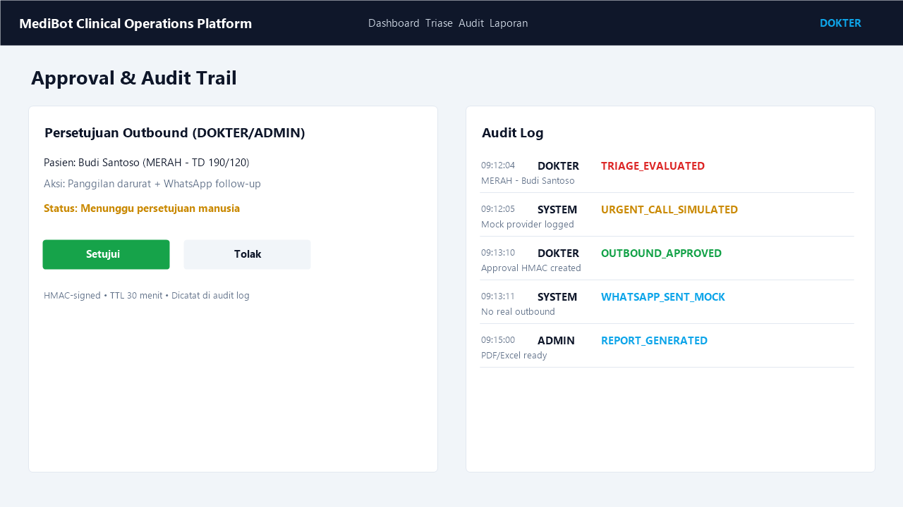
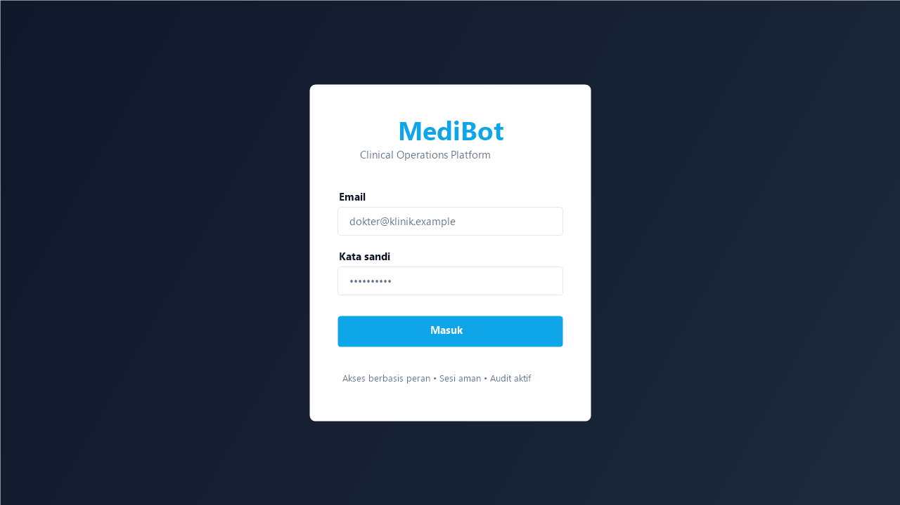

# MediBot Clinical Operations Platform

**English** | [Bahasa Indonesia](README.id.md)

> Multi-agent clinical operations foundation for Indonesian clinics — secure by default, mock by default, auditable by design.

[](https://github.com/riyanda-ex/medi-bot-agency-v3/actions/workflows/ci.yml)


MediBot Clinical Operations Platform is a Next.js App Router system that orchestrates seven specialized agents for clinical triage, medical record analysis, reporting, security auditing, and patient engagement. It is built for **safe local development first** and includes production hardening controls.

> **Important medical disclaimer:** This software is a decision-support prototype, **not a certified medical device**. Triage thresholds are internal rules and must be clinically validated before any real-patient use.


## Screenshots

| Dashboard Triase | Approval & Audit | Login |
|---|---|---|
|  |  |  |

## Table of Contents

- [Key Features](#key-features)
- [Security Posture](#security-posture)
- [Tech Stack](#tech-stack)
- [Quick Start](#quick-start)
- [Available Scripts](#available-scripts)
- [Project Structure](#project-structure)
- [Configuration](#configuration)
- [Production Deployment](#production-deployment)
- [Documentation](#documentation)
- [Contributing & Security](#contributing--security)
- [License & IP](#license--ip)

## Key Features

- **7 agents**: RME Analyzer, Orchestrator, Bug Hunter, Auto Reporter, Urgent Triage + Auto Caller, Security Guard, Patient Engagement.
- **Role-based access**: DOKTER, PERAWAT, RESEPSIONIS, ADMIN, PASIEN with fail-closed RBAC.
- **Urgent triage workflow**: rule-based RED/YELLOW/GREEN evaluation with audit logging and simulated outbound follow-up.
- **Human approval gate**: real outbound actions require explicit DOKTER/ADMIN approval (HMAC-signed, 30-minute TTL).
- **Auditability**: signed audit records for API access, denials, approvals, and critical actions.
- **Reporting**: PDF/Excel daily reports with download containment under `reports/`.
- **Safe defaults**: mock WhatsApp/phone/email providers, no real keys in repo, outbound disabled by default.

## Security Posture

Implemented controls:

- NextAuth credentials + JWT, DB session revalidation, invalid-session blocking.
- Fail-closed RBAC and role-aware data redaction (diagnosis hidden from unauthorized roles).
- AES-256-GCM field encryption for sensitive patient fields; NIK hashing/masking.
- Signed audit logs with actor/role/method/path/IP/user-agent context.
- Rate limiting, same-origin checks for mutating APIs, `Cache-Control: no-store` on API responses.
- Security headers/CSP via `next.config.mjs` and protected-route proxy headers.
- Signed/Zod-validated queue jobs; Redis production checks for password/TLS on public hosts.
- Production env guards reject placeholder/DEV/CI secrets, `SYNC_MODE=true`, and disabled human approval.

> No system can be guaranteed “unhackable”. Before real clinical deployment, complete the [Production Checklist](docs/PRODUCTION-CHECKLIST.md), external penetration testing, and legal/compliance review.

## Tech Stack

| Area       | Technology                                                           |
| ---------- | -------------------------------------------------------------------- |
| Framework  | Next.js 16.4.6 (App Router), React 19                                |
| Language   | TypeScript (strict)                                                  |
| Styling/UI | Tailwind CSS, shadcn/ui pattern, Radix primitives                    |
| Data       | Prisma, SQLite (dev default), PostgreSQL (production)                |
| Auth       | NextAuth Credentials/JWT                                             |
| Queue      | Sync mode default; BullMQ + Redis optional                           |
| Testing    | Vitest, E2E script, queue check script                               |
| CI         | GitHub Actions (Windows verify, PostgreSQL/Redis E2E, BullMQ worker) |

## Quick Start

### Prerequisites

- Windows PowerShell (tested), Node.js 22+, npm 11+
- Docker **not required** for local dev (SQLite + `SYNC_MODE=true`)

### Install & Run

```powershell
Copy-Item .env.example .env
npm install
npm run db:setup
npm test
npm run dev
```

Open `http://localhost:3000`.

### Local Development Accounts

> For local development only. Login form does not auto-fill credentials. Production seeding is blocked unless `ALLOW_SEED=true` with a strong `SEED_PASSWORD`.

| Role        | Email                        | Password      | Diagnosis Access |
| ----------- | ---------------------------- | ------------- | ---------------- |
| DOKTER      | `dokter@klinik.example`      | `password123` | Yes              |
| PERAWAT     | `perawat@klinik.example`     | `password123` | Triage only      |
| RESEPSIONIS | `resepsionis@klinik.example` | `password123` | No               |
| ADMIN       | `admin@klinik.example`       | `password123` | Yes              |
| PASIEN      | `pasien@klinik.example`      | `password123` | Own data         |

## Available Scripts

| Command                      | Description                                                |
| ---------------------------- | ---------------------------------------------------------- |
| `npm run dev`                | Start Next.js development server.                          |
| `npm run build`              | Create production build.                                   |
| `npm run start`              | Start production server.                                   |
| `npm run typecheck`          | Run TypeScript checks.                                     |
| `npm test`                   | Run Vitest suite.                                          |
| `npm run db:setup`           | Generate Prisma client, push SQLite schema, seed dev data. |
| `npm run db:studio`          | Open Prisma Studio.                                        |
| `npm run prisma:generate:pg` | Generate PostgreSQL Prisma schema/client.                  |
| `npm run db:setup:pg`        | Push + seed PostgreSQL (requires `DATABASE_URL`).          |
| `npm run queue:worker`       | Run BullMQ worker (requires `QUEUE_MODE=redis`).           |
| `npm run verify:agents`      | Smoke-test agents and DB.                                  |
| `npm run e2e`                | Run HTTP E2E checks against running server.                |
| `npm run queue:check`        | Verify Redis queue returns 202 + `jobId`.                  |

## Project Structure

See [`docs/STRUCTURE.md`](docs/STRUCTURE.md) for placement rules and security-sensitive areas.

```text
app/         Next.js App Router UI + API routes
agents/      7 domain agents
lib/         Shared auth/rbac/env/crypto/audit/queue/guards
components/  UI components
prisma/      Schema + seed
scripts/     Worker, E2E, queue checks, schema sync
tests/       Vitest tests
fixes/       Bug-hunter artifacts/helpers
docs/        Architecture, API, structure, production checklist
.github/     CI, Dependabot, templates, CODEOWNERS
```

## Configuration

Copy `.env.example` to `.env`. Key variables:

| Variable                 | Default      | Purpose                                                   |
| ------------------------ | ------------ | --------------------------------------------------------- |
| `WHATSAPP_PROVIDER`      | `mock`       | `mock`, `fonnte`, `wablas`                                |
| `PHONE_PROVIDER`         | `mock`       | `mock`, `twilio`                                          |
| `ALLOW_REAL_OUTBOUND`    | `false`      | Enables real outbound providers only with approval gates. |
| `REQUIRE_HUMAN_APPROVAL` | `true`       | Required for real outbound; forced in production.         |
| `QUEUE_MODE`             | `sync`       | `sync` or `redis`.                                        |
| `REDIS_URL`              | -            | Required for Redis queue mode.                            |
| `TRUST_PROXY`            | empty        | Trusted proxy IPs for forwarded client IP.                |
| `SYNC_MODE`              | `true` (dev) | Must be `false` in production.                            |

See `.env.example` for the full list.

## Production Deployment

1. Follow [`docs/PRODUCTION-CHECKLIST.md`](docs/PRODUCTION-CHECKLIST.md).
2. Provision PostgreSQL + Redis (private network, auth/TLS as needed).
3. Set strong secrets and production env guards.
4. Run:

```powershell
docker compose up -d
npm run db:setup:pg
npm run build
npm run queue:worker
npm run start
```

`QUEUE_MODE=redis` returns HTTP 202 + `jobId` for queued work; run the worker as a separate process.

## Documentation

- [`docs/ARCHITECTURE.md`](docs/ARCHITECTURE.md) — system design and data flow.
- [`docs/API.md`](docs/API.md) — API endpoint summary.
- [`docs/STRUCTURE.md`](docs/STRUCTURE.md) — repository layout and placement rules.
- [`docs/PRODUCTION-CHECKLIST.md`](docs/PRODUCTION-CHECKLIST.md) — deployment hardening checklist.
- [`TESTING.md`](TESTING.md) — testing protocol.
- [`PLAN.md`](PLAN.md) — implementation plan and status.
- [`SECURITY.md`](SECURITY.md) — vulnerability reporting.
- [`CHANGELOG.md`](CHANGELOG.md) — notable changes.

## Contributing & Security

- Read [`CONTRIBUTING.md`](CONTRIBUTING.md) and [`CODE_OF_CONDUCT.md`](CODE_OF_CONDUCT.md).
- **Do not report security vulnerabilities in public issues.** Follow [`SECURITY.md`](SECURITY.md).
- This repository is proprietary; external contributions require written owner authorization.

## License & IP

- [`LICENSE`](LICENSE) — Proprietary commercial license v3.1 (All Rights Reserved). Owner: `riyanda-ex`.
- [`PATENT.md`](PATENT.md) — Patent status and draft materials. **No patent has been filed or granted.** Do not label as “Patent Pending” without official evidence.

This README is informational and not legal or medical advice.
